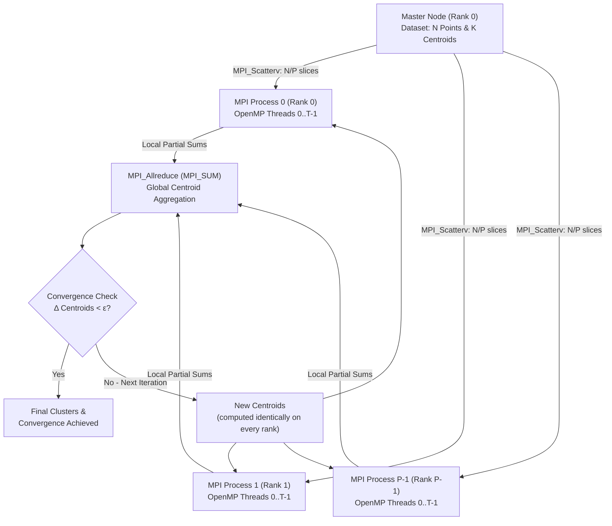

# Parallel K-Means Clustering on Large-Scale Datasets using Hybrid MPI + OpenMP

**Course:** Parallel and Distributed Computing (PDC) — FAST NUCES, Karachi Campus
**Project proposal:** Submitted (Parallel K-Means, Hybrid MPI + OpenMP)

| Member | ID |
|---|---|
| Muddassir Rizwan | 23K-0784 |
| Faiz Hussain | 23K-2061 |
| Qaim Mehdi | 23K-2075 |

## Problem & Objective

K-Means clustering groups N unlabeled data points (D dimensions each) into K clusters using Lloyd's algorithm: assign every point to its nearest centroid, then recompute each centroid as the mean of its assigned points, repeating until convergence. Its cost is **O(N × K × D × I)** (I = iterations), which becomes a bottleneck on modern datasets (e.g. 1M points × 128 dimensions × 64 clusters). Profiling shows ~95% of runtime is spent computing Euclidean distances between points and centroids — and those calculations are independent per point, so the phase is inherently parallelizable.

This project implements a **high-performance hybrid parallel K-Means in C**:

1. A **serial baseline** to verify correctness.
2. A **two-level parallel architecture**: MPI between processes (distributed memory, coarse-grained) + OpenMP inside each process (shared memory, fine-grained).
3. **Strong & weak scaling benchmarks**, analyzed for speedup, parallel efficiency, communication overhead, and compared against Amdahl's Law.

## Architecture

Single Program Multiple Data (SPMD): every MPI process runs the same program on its own slice of the data.



**Iteration workflow**

1. **Initialization** — Rank 0 loads dataset metadata, selects the initial K centroids, broadcasts them.
2. **Data Distribution** — the dataset is split into contiguous blocks of N/P points and distributed with `MPI_Scatterv` (variable counts, so N does not need to divide evenly by P). Each process stores only its local slice.
3. **Distance Calculation (OpenMP)** — inside each process, `#pragma omp parallel for schedule(static)` assigns local points to their nearest centroid across the available threads.
4. **Centroid Synchronization** — each rank computes local coordinate sums and per-cluster point counts; `MPI_Allreduce` with `MPI_SUM` aggregates them globally. Because every rank receives the global sums, every rank computes the **same new centroids locally** — no separate broadcast is needed.
5. **Convergence Check** — if centroid displacement < ε (or max iterations reached), the algorithm terminates; otherwise the next iteration starts.

| Phase | Execution Mode | PDC Technology & Method |
|---|---|---|
| Data Loading & Initialization | Serial (Master) | File I/O on Rank 0 |
| Data Distribution | Parallel (Inter-Process) | `MPI_Scatterv` — N rows into P contiguous block slices |
| Distance Computation | Parallel (Intra-Process) | OpenMP `#pragma omp parallel for schedule(static)` |
| Centroid Synchronization | Parallel (Inter-Process) | `MPI_Allreduce(MPI_SUM)` on K×D sums and counts |
| Convergence Check | Collective / Replicated | Displacement vs tolerance ε, identical on all ranks |

See [docs/architecture.md](docs/architecture.md) for design details and decisions.

## Repository Structure

```
.
├── src/         # C implementations: serial, MPI, OpenMP, hybrid
├── scripts/     # Python dataset generation & plotting
├── data/        # Generated datasets (not committed — see data/README.md)
├── benchmarks/  # Benchmark results (CSV) and scaling plots
├── report/      # Final report and viva slides
├── docs/        # Architecture and milestone documentation
└── Makefile     # Build targets for all implementations
```

## Environment Setup

Ubuntu 22.04 LTS (or WSL2), GCC with OpenMP support, OpenMPI:

```bash
sudo apt update
sudo apt install build-essential openmpi-bin libopenmpi-dev python3 python3-numpy python3-matplotlib
```

## Build & Run

```bash
make            # build whichever implementations exist so far
make serial     # -> bin/kmeans_serial      (Milestone 1)
make mpi        # -> bin/kmeans_mpi         (Milestone 2)
make omp        # -> bin/kmeans_omp         (Milestone 3)
make hybrid     # -> bin/kmeans_hybrid      (Milestone 4)
make clean
```

Planned usage (arguments finalized with Milestone 1):

```bash
# generate a dataset: N points, D dimensions, true clusters, seed
python3 scripts/gen_data.py --points 100000 --dims 16 --clusters 8 --seed 42 --out data/small.bin

./bin/kmeans_serial  data/small.bin 8 100 0.0001
mpirun -np 4 ./bin/kmeans_mpi     data/small.bin 8 100 0.0001
mpirun -np 2 ./bin/kmeans_hybrid  data/small.bin 8 100 0.0001   # + OMP_NUM_THREADS=2 per process
```

Timing uses `MPI_Wtime()` / `omp_get_wtime()`; benchmark runs are repeated 3–5 times and reported as mean ± standard deviation.

## Benchmark Workloads

| Tier | Points (N) | Dimensions (D) | Clusters (K) | Objective |
|---|---|---|---|---|
| Small | 100,000 | 16 | 8 | Debugging & correctness checks |
| Medium | 500,000 | 64 | 32 | Thread scaling, memory profiling |
| Large | 1,000,000 | 128 | 64 | Primary strong & weak scaling benchmarks |
| Extra Large | 5,000,000 | 32 | 16 | Stress testing |

- **Strong scaling:** fixed dataset, 1/2/4/8 processing units → Speedup S = T₁/Tₚ, Efficiency E = S/P
- **Weak scaling:** dataset grows proportionally with MPI ranks → near-flat time indicates good scaling
- **Amdahl's Law:** serial fraction estimated from the sequential profile (expected s ≈ 0.02–0.05), observed speedup compared with the theoretical maximum

## Milestones

| # | Milestone | Status |
|---|---|---|
| M0 | Repository setup (README, Makefile, structure) | ✅ Done — 2 Nov 2026 |
| M1 | Serial baseline in C + dataset generator | ⬜ Planned |
| M2 | MPI version (Scatterv + Allreduce) | ⬜ Planned |
| M3 | OpenMP version (parallel assignment loop) | ⬜ Planned |
| M4 | Hybrid MPI + OpenMP integration & correctness vs serial | ⬜ Planned |
| M5 | Strong/weak scaling benchmarks & plots | ⬜ Planned |
| M6 | Final report & viva presentation | ⬜ Planned |

Details in [docs/milestones.md](docs/milestones.md).

## Expected Deliverables

1. Working, modular Hybrid MPI + OpenMP K-Means implementation in C with a clean Makefile.
2. Verification that parallel clustering assignments match the serial baseline.
3. Measurable speedup and efficiency gains on multi-core hardware.
4. Scaling plots (Speedup vs Cores, Efficiency, Weak Scaling).
5. Final report explaining findings and communication trade-offs, plus a viva presentation.
